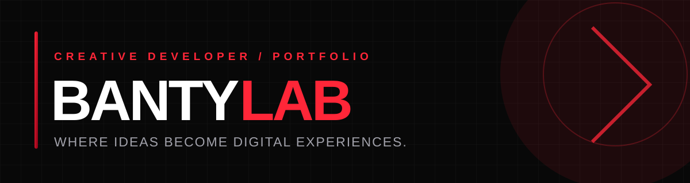

  <b>More Than Code. Crafting Digital Experiences.</b> 
  Creative Developer · Full-Stack Builder · BANTY LAB

<table>
<tr>
<td width="58%" valign="middle">01 — THE PERSON BEHIND THE CODE
Hey, I'm Banty. 
I create modern websites and web applications with a focus on clean interfaces, useful functionality and thoughtful details.

I enjoy taking an idea from its first sketch to a working digital product — building the frontend, connecting the backend and polishing the experience.
- 🔴 Building my creative identity: BANTY LAB
- ⚡ Frontend: React, TypeScript, JavaScript, Tailwind CSS
- 🛠️ Backend: Laravel, PHP, MySQL
- 🎬 Interested in motion, interaction and UI details
- 📍 Bihar, India

</td>
<td width="42%" align="center" valign="middle"></td>
</tr>
</table>

02 — WHAT I WORK WITH

TOOLS ARE JUST THE START. THE EXPERIENCE IS WHAT MATTERS.

03 — SELECTED PROJECTS

A FEW IDEAS I'VE BEEN BUILDING AND EXPLORING.
<table>
<tr>
<td width="50%" valign="top">🔎 PATNA FINDER
Local discovery platform

A platform concept focused on helping people discover businesses, places and useful services around Patna.

Next.js · Web · Local Discovery
</td>
<td width="50%" valign="top">✦ ZUEX
Premium fashion experience

A premium fashion commerce concept combining ready-to-wear collections with custom and made-to-measure experiences.

E-commerce · Fashion · UI/UX
</td>
</tr>
<tr>
<td width="50%" valign="top">🛍️ RECELL
E-commerce web application

An e-commerce project focused on product discovery, shopping flows and a smooth customer experience.

Laravel · PHP · MySQL
</td>
<td width="50%" valign="top">✧ QUIZAI
AI-powered quiz project

An exploration of AI-powered content creation and interactive quiz experiences.

AI · Web Application
</td>
</tr>
</table>
04 — GITHUB, IN MOTION

THE WORK, THE LEARNING, THE ITERATION.

&nbsp;

05 — LET'S BUILD SOMETHING
HAVE AN IDEA? LET'S TURN IT INTO A DIGITAL EXPERIENCE.

&nbsp;

<b>KEEP BUILDING. KEEP SHIPPING.</b>

© BANTY LAB · WHERE IDEAS BECOME DIGITAL EXPERIENCES.

